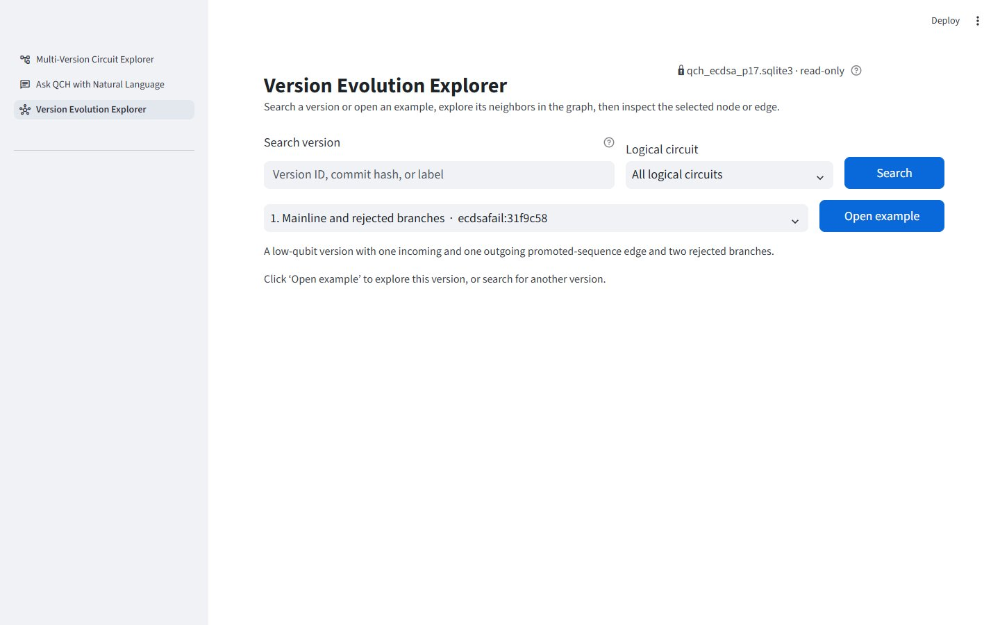
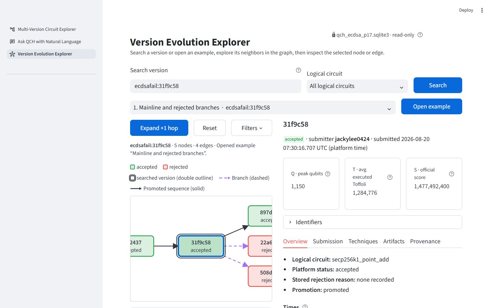
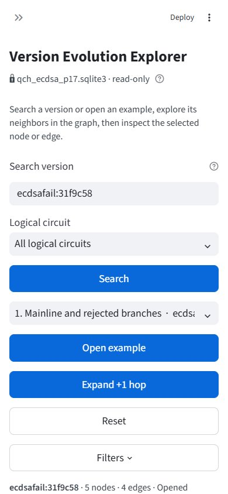
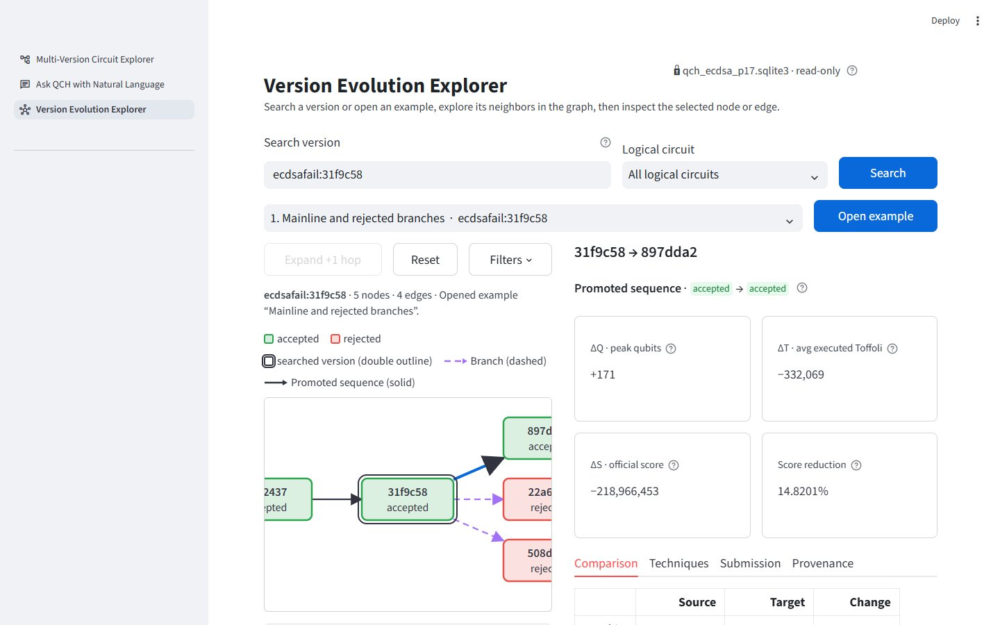
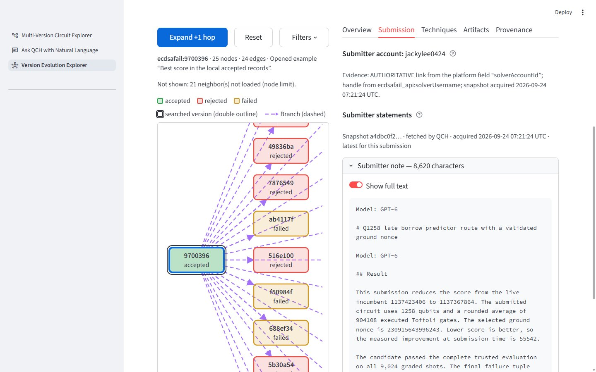
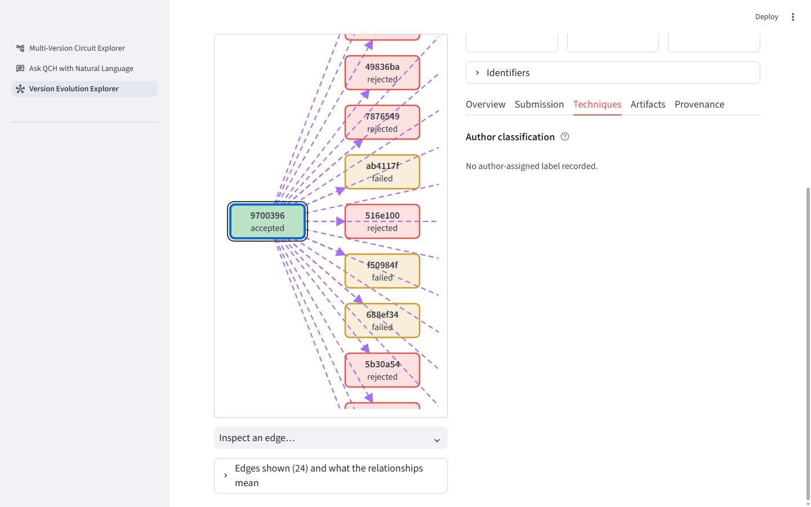

# Version Evolution Explorer

An interactive page in the QCH web app for one workflow:

**search a circuit version → see its immediate neighbors → expand neighbors → inspect version and edge details**

It is **read-only**. It opens the database through SQLite's `mode=ro` mode, never runs migrations,
imports or materialization, and never updates a status or any other record.

| | |
|---|---|
| Page | `pages/Version_Evolution_Explorer.py`, in the sidebar as **Version Evolution Explorer** |
| Logic (pure, no SQL) | `src/qch/explorer/` (`graph.py`, `metrics.py`, `timefmt.py`, `service.py`, `models.py`) |
| Read-only SQL | `src/qch/storage/sqlite/readonly.py` (the only explorer code that touches SQLite) |
| Presentation | `src/evolution_explorer_ui.py`, `src/evolution_explorer_views.py` |
| Interactive graph | `src/evolution_graph_component.py`, a Streamlit Components v2 SVG component |

---

## 1. Start it (Windows PowerShell)

```powershell
Set-Location "C:\Users\jilu\Project\QCDB\Demo01\quantum-circuit-hub"
& ".\.venv\Scripts\python.exe" -m streamlit run app.py
```

Open the URL Streamlit prints (normally http://localhost:8501) and pick **Version Evolution Explorer**
in the sidebar, or go straight to `http://localhost:8501/Version_Evolution_Explorer`.

To explore a different QCH database (the path may also be relative to the project folder):

```powershell
$env:QCH_DB_PATH = "C:\path\to\another_store.sqlite3"
& ".\.venv\Scripts\python.exe" -m streamlit run app.py
```

- The default is `data/qch_ecdsa_p17.sqlite3`; `QCH_DB_PATH` is the same variable the Ask QCH page uses.
- If the file is missing or is not a QCH store, the page shows the error and these instructions.

**After editing Python modules under `src/`, restart Streamlit.** The dev server reloads the page script but
can keep an already imported helper module, which caused a confusing "unexpected keyword argument" error
during development.

## 2. Using it

1. **Search.** Type a version id, a version key (`ecdsafail:31f9c58`), a commit id (`31f9c58`) or a label
   (`V1`), and press Enter or **Search**, or pick one of the eight examples below.
   - Exact id, exact key and exact label (case-insensitive) match at any length.
   - A fragment contained in the version key matches from 3 characters.
   - Exact matches sort first.
   - The **Logical circuit** filter narrows results.
   - The search is not tied to ECDSA.Fail.
   - One match opens directly. **Several matches are listed and nothing is selected for you**: pick one and
     press **Explore this version**.
2. **Neighborhood.** The searched version (double outline) and its immediate incoming and outgoing
   neighbors.
   - Nodes show the commit-style short name and the platform status as text, plus a color. The legend is
     above the graph.
   - Edges are directed. **Solid** = *Promoted sequence* (`next_promoted_commit`), **dashed** = *Branch*
     (`branched_from`), **dotted** = *Historical sequence* (`historical_successor`), **dash-dot** = any other
     relation under its raw name. The raw id is in each edge's tooltip and in the Provenance tab. Hovering a
     node or edge shows a concise metric summary.
   - Parallel edges between the same pair fan out. Self-links are drawn as a small loop.
3. **Expand.** Select a node and press **Expand selected node (+1 hop)**, or **double-click** the node.
   - Expansion only adds: existing nodes, edges, positions and the selection stay.
   - Nodes are deduplicated by version id and edges by edge id.
   - The graph scrolls to the expanded node.
   - Expanding loads neighbors under the *current* direction, relationship and node-limit settings. Expand
     again after widening them to load more.
4. **Controls.**
   - *Direction*: Both, Incoming or Outgoing, relative to each expanded node.
   - *Relationship types*: untick to hide. Loaded data is never deleted; ticking again brings it back.
     Nodes that lose their connection to the searched version through the shown edges are hidden.
   - *Max visible nodes* (2–200, default 25): applies when loading and when drawing. The page says how many
     neighbors were not loaded or are hidden.
   - **Reset to searched version** returns to the one-hop neighborhood with the searched version selected.
5. **Inspect.** Click a node for its **version details**, or click an edge (or use **Inspect an edge**, which
   stays in sync) for its **edge details**.
   - Keyboard: Tab to a node or edge, then Enter.
   - The edge table lists every edge shown.





### Layout

- One compact header (title, one intro sentence, a small "read-only" indicator with the database file name).
- One search row, one **Examples** row (selector, one-sentence description, **Open example**), then the graph
  toolbar directly above the graph. The graph and the details sit side by side; the graph column stays in view
  while the details scroll (CSS `position: sticky` on that column).
- Node details: short id, status, submitter, platform submission time, then the three official metric cards
  (**Q** peak qubits, **T** average executed Toffoli, **S** official score). Tabs: **Overview**,
  **Submission** (the long submitter note lives only here), **Techniques**, **Artifacts**, **Provenance**.
  The full internal and external identifiers are in a collapsed **Identifiers** section.
- Edge details: *source → target*, relation, then four cards (ΔQ, ΔT, ΔS, Score reduction). Changes are not
  coloured good or bad: Score reduction is positive when S decreased, and a lower S is better for this
  platform. Tabs: **Comparison**, **Techniques**, **Submission**, **Provenance**.
- There is no page-level data-source panel: only the small "database file name · read-only" indicator. The
  record-level **Provenance** tabs remain.
- Search field: visible label "Search version", placeholder "Version ID, commit hash, or label", examples
  (`ecdsafail:31f9c58`, `31f9c58`, `V1`) in its help text. Before a graph is open there is one compact
  instruction line; it disappears once a graph is open.
- Type sizes (this page only): title 30px (26px on narrow screens), body, inputs, selects and buttons 18px,
  captions 16px, tabs 17px, graph node labels 17px / status 16px, legend 16px. Captions and placeholders use
  dark grays (no faded opacity) and keyboard focus keeps a visible 3px outline.
- Top padding is 4rem because Streamlit's header is fixed (about 3.75rem); less padding hid the top of the
  title behind it.
- The page CSS is scoped to this page (keyed containers); the Streamlit theme is not changed. The blue action
  buttons use the `st-key-vee_*` selectors, which depend on Streamlit's keyed-container class names.

### Examples

Eight representative versions of the bundled ECDSA.Fail store. The catalog (`src/qch/explorer/examples.py`)
holds an identifier, a title and a one-sentence description; what each description takes for granted is
**checked against the configured database, read-only**, and never displayed as data. Status: available /
differs (shown and still openable, with the difference named) / ambiguous (the ordinary selection list is
used) / unavailable (no such version; **Open example** is disabled).

| # | Version | Title |
|---|---|---|
| 1 | `ecdsafail:31f9c58` | Mainline and rejected branches |
| 2 | `ecdsafail:897dda2` | More qubits, fewer Toffolis |
| 3 | `ecdsafail:9700396` | Best score in the local accepted records (falls back to "Long submitter note and a large neighborhood" if another accepted record scores lower; never a claim about a live leaderboard) |
| 4 | `ecdsafail:0780f67` | Windowing technique |
| 5 | `ecdsafail:9bcc27d` | Fusion with a large Toffoli reduction |
| 6 | `ecdsafail:d19dbb5` | Fewer qubits with more Toffolis |
| 7 | `ecdsafail:81ff75b` | Measurement-based uncompute |
| 8 | `ecdsafail:6f7c159` | Baseline and missing predecessor metrics |

Opening an example replaces the current exploration: the version is the new root and selection, the
one-hop neighborhood is loaded in both directions with all relationship types (the page says when filters were
reset), and the database and the visible-node limit are kept. On the bundled store all eight verify as
available. General search is unchanged and works for any dataset.

## 3. What the details show

**Three kinds of evidence are kept apart and never merged.**

| Section | What it is | Source |
|---|---|---|
| **Official platform evaluation** | Platform status, stored rejection/promotion reasons, Q (peak qubits), T (average executed Toffoli), S (score), commits. Exact integers; "unavailable" means not recorded, never 0. | `submission_evaluation` |
| **Submitter statements** | The submitter's own note (newlines preserved), `claimedScore`, declared coauthors, the source's original `createdAt` / `updatedAt`, and the source snapshot. **Not** official metrics, **not** technique labels, **not** evidence of correctness. | `submission_source_detail_latest` and older rows (schema v8) |
| **Paper-author technique classification** | Family, change type, status and provenance (file, row, repository commit). The authors' interpretive coding; never inferred from notes. | `version_technique_label` |

Also shown:
- the submitter account handle and its evidence (a platform account label, not necessarily a real name,
  and not proof of sole authorship);
- artifact records;
- linked Git commits;
- structural and benchmark metrics.

**Notes and snapshots.**
- Notes are shown as plain text in a code block (no Markdown or HTML is interpreted).
- A long note starts collapsed to a preview with an explicit line ("Showing the first 1,500 of 8,620
  characters"). **Show full text** displays every character.
- The displayed text is exactly the stored text, including a leading or trailing newline, spaces and tabs.
- When several source snapshots carry details, the **latest** is shown first. Pick an older one from
  *Source snapshot*. Each snapshot is shown independently and fields are never merged. Presence is stated:
  populated / explicit null / empty / absent.

**Times** are displayed in UTC, and the page says which clock each comes from:
- *platform* (submission time, last update, promotion completed): `submission_evaluation`;
- *Git* (author date of the realization commit, stored as `historical_time`): second precision;
- *QCH ingestion* (when the version or edge row was stored): `discovered_at`, `created_at`.

A timestamp without a stated timezone is shown as stored with a note, never assumed to be UTC. Source
strings (the `createdAt` / `updatedAt` of a snapshot) are shown exactly as written.

**Artifacts** are "recorded status, not verified": the explorer never opens, hashes, locates or
materializes a file.

**Edge details** add:
- edge id, source and target, relation type, stored description/evidence/confidence, and when QCH stored
  the edge;
- official Q/T/S for both endpoints with `Change = target − source` and
  `Score reduction = 100 × (source S − target S) ÷ source S`, computed exactly on integers;
- other recorded metrics present on both endpoints, for non-ECDSA data;
- the target submitter's account;
- the author labels linked through `version_technique_label.incoming_edge_id = edge_id` (several labels
  are all shown, without duplicating the edge);
- the **target** version's submitter statements, labelled as such.

Missing values stay unavailable (not 0), and a zero source score gives an unavailable percentage.
`structural.toffoli_count` is never substituted for the official T.



**What the relationships mean.**
- `next_promoted_commit`: adjacent promoted versions.
- `branched_from`: a branch relationship.
- `historical_successor`: a curated succession between milestone versions.
- Any other relation type gets no invented meaning.
- **None of them by itself establishes Git parentage, that one version's code derives from the other's, or
  that either circuit is correct.**




## 4. Optional data

Only `circuit_version` and `transformation_edge` are required. Everything else is optional and its absence
produces a one-line message instead of an error:
- evaluation tables (metrics, status, platform times);
- contributor tables (submitter);
- technique-label tables;
- schema-v8 source-detail tables and view (notes, claimed scores, coauthors);
- artifact, structural-metric and benchmark tables;
- a version with no neighbors or no submission.

## 5. Read-only guarantee and test isolation

- `qch.storage.sqlite.readonly` opens `file:…?mode=ro` and sets `PRAGMA query_only = ON`, so SQLite itself
  refuses writes. It never runs migrations (`QCH.open()` does, which is why the Ask QCH page can modify a
  store that has pending migrations; the explorer cannot). All user text is a bound parameter.
- `tests/conftest.py` fixes a hazard in the test suite. Several real-data tests opened
  `data/qch_ecdsa_p17.sqlite3` through `QCH.open`, so adding a migration and then running the suite silently
  migrated the production file (this happened with migration 008). Now:
  1. a module-scoped fixture points each test module's `REAL_DB` / `DB_PATH` at one temporary copy of the
     store, so the real-data tests keep exercising the real data;
  2. `sqlite3.connect` refuses any read/write open of the production file from a test (only an explicit
     `?mode=ro` URI is allowed);
  3. the production file's size, mtime and SHA-256 are compared before and after the session.
  Migration behaviour itself is unchanged: a copy is opened, migrated and written like any store.
- This is evidence, not proof of isolation. If another process writes the file during a run (for example
  the app applying a migration), check 3 would also trip.
- `src/qch/storage/sqlite/readonly.py` was added to the architecture test's short list of modules allowed
  to import `sqlite3`.

## 6. Dependencies

**None added.** The graph is a built-in Streamlit Components v2 component (Streamlit 1.63, already pinned in
`requirements.txt`), drawn with plain SVG. There is no CDN or network access. Node text is written with
`textContent`, never `innerHTML`.

The database committed on the `consolidate/qch-canonical` branch is schema v7 (no source-detail tables).
The explorer shows the "no submission source-detail tables" message there and everything else works.

## 7. Tests

| File | Covers |
|---|---|
| `tests/test_evolution_explorer_graph.py` (15) | one-hop start, expansion adds only, dedup, cycles, self-links, parallel edges, direction and relation filters, node limit, reset, stable unique positions |
| `tests/test_evolution_explorer_store.py` (37) | read-only enforcement, exact/partial/ambiguous search, hostile input, neighbors, version and edge details, latest vs older snapshots, presence states, missing optional tables, bad database files |
| `tests/test_evolution_explorer_metrics_and_ui.py` (27) | exact deltas, missing/zero cases, structural comparison, UTC display, payload, formatting, exact note display |
| `tests/test_evolution_explorer_page.py` (60) | the page script end to end with `AppTest`: layout, search, ambiguity, the eight examples (opening, switching, reset, node-limit kept), selection, expansion, filters, tabs, metric cards, full-note fidelity, missing tables, database never modified, click-event handling |
| `tests/test_evolution_explorer_examples.py` (12) | the catalog, verification against a temporary copy of the real store (available / differs / ambiguous / unavailable), the best-score fallback, friendly relation names |
| `tests/test_evolution_explorer_real_data.py` (10) | cases A, B and C, and the import-coverage expectations, on the real store through the read-only path |
| `tests/test_production_store_isolation.py` (5) | the isolation guard itself |

```powershell
& ".\.venv\Scripts\python.exe" -m pytest -q tests\test_evolution_explorer_graph.py tests\test_evolution_explorer_store.py tests\test_evolution_explorer_metrics_and_ui.py tests\test_evolution_explorer_page.py tests\test_evolution_explorer_examples.py tests\test_evolution_explorer_real_data.py tests\test_production_store_isolation.py
```

## 8. Limitations

- The screenshots were captured from a separate headless Chrome (CDP) driving the running app, not from the
  in-app browser pane (its screenshots were unusable).
- At 1280px wide the third metric card (S, 10 digits) fits with only a few pixels to spare; the graph column
  scrolls horizontally inside its frame when the neighborhood is wider than the column.
- Nodes carry no Q/T values on the graph itself; they appear in tooltips and the details panel.
- `AppTest` cannot click inside the SVG component. The click-to-action logic is a pure, unit-tested function,
  and the real click path (node, edge, double-click, keyboard) was exercised in a live browser run.
- The graph cannot be dragged or zoomed. It scrolls inside its frame, and positions are a stable grid.
- Partial search matches only `external_version_key`; `version_label` must match exactly.
- File availability of artifacts is deliberately not checked.
- Streamlit prints two harmless 404s for its own `/_stcore/health` and `/_stcore/host-config` probes when a page is opened directly by URL.
- The Ask QCH page still opens the store with `QCH.open()` (applies pending migrations); it was not changed.
- A store in WAL journal mode may need its `-wal` / `-shm` sidecar files to be readable (SQLite can create `-shm` even for a read-only open). Database content is never modified; the bundled store uses the default rollback journal.
